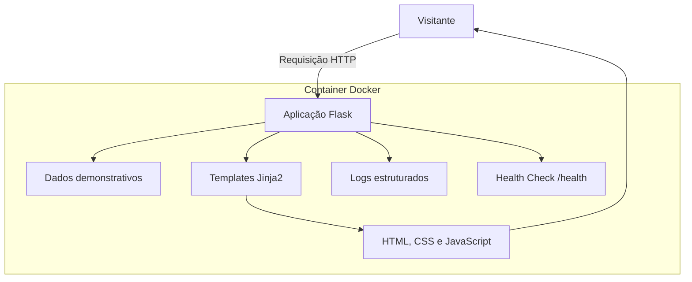
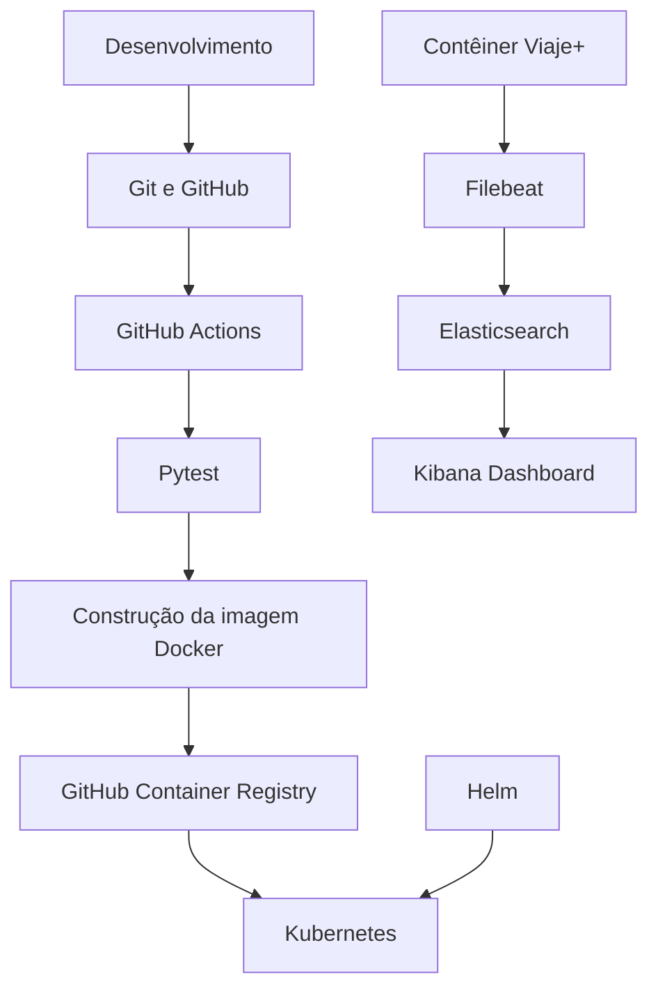
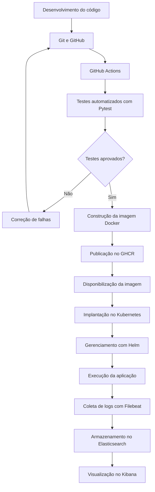

# Viaje+ — Portal de Turismo e Aplicação de Práticas DevOps

## 1. Sobre o projeto

O Viaje+ é uma aplicação web de divulgação de destinos turísticos nacionais e internacionais, desenvolvida com o objetivo de proporcionar aos visitantes uma experiência visual moderna e intuitiva para descobrir diferentes possibilidades de viagem.

A plataforma concentra sua experiência em uma página inicial (*Landing Page*), que reúne a apresentação do serviço, destinos turísticos em destaque e informações introdutórias sobre as possibilidades de viagem.

Além do desenvolvimento da aplicação web, o Viaje+ demonstra, na prática, a aplicação de princípios e ferramentas DevOps ao ciclo de vida de um software, abrangendo atividades de desenvolvimento, testes, integração contínua, containerização, implantação e observabilidade.

## 2. Motivação e propósito

Em projetos de software, desenvolver uma aplicação funcional é apenas uma parte do processo. Também é necessário garantir que as alterações realizadas pelos desenvolvedores sejam verificadas, que o ambiente de execução seja reproduzível e que a disponibilização de novas versões ocorra de maneira organizada e confiável.

Nesse contexto, o Viaje+ foi desenvolvido para explorar os desafios relacionados à integração entre desenvolvimento e operações de software.

A proposta utiliza uma aplicação web como base para implementar um fluxo de trabalho DevOps, demonstrando como diferentes ferramentas podem atuar de maneira integrada para automatizar atividades, reduzir intervenções manuais e melhorar a confiabilidade do processo de entrega.

O projeto busca responder a questões como:

- Como garantir que alterações no código não comprometam funcionalidades existentes?
- Como automatizar a execução de testes a cada atualização do projeto?
- Como padronizar o ambiente de execução, evitando diferenças entre máquinas?
- Como automatizar a construção e a disponibilização de novas versões?
- Como organizar a execução da aplicação em ambientes de contêineres?
- Como acompanhar o comportamento da aplicação e analisar seus registros de execução?

Essas questões orientaram as decisões tecnológicas e arquiteturais adotadas no projeto.

## 3. Objetivos

### 3.1 Objetivo geral

Desenvolver uma aplicação web integrada a um fluxo de práticas DevOps, demonstrando a utilização de automação, integração contínua, containerização, orquestração e observabilidade no ciclo de desenvolvimento e entrega de software.

### 3.2 Objetivos específicos

- Desenvolver uma aplicação web utilizando Python e Flask.
- Organizar o código-fonte e controlar suas alterações por meio do Git e GitHub.
- Implementar testes automatizados para validar o funcionamento da aplicação.
- Utilizar GitHub Actions para automatizar a integração contínua.
- Empregar Docker para padronizar e isolar o ambiente de execução.
- Utilizar o GitHub Container Registry para armazenar e disponibilizar imagens da aplicação.
- Implementar a implantação e o gerenciamento de contêineres utilizando Kubernetes e Helm.
- Implementar uma estrutura de coleta e visualização de logs com Filebeat, Elasticsearch e Kibana.

## 4. Arquitetura da solução

A arquitetura do Viaje+ foi planejada de forma modular e simplificada, separando a apresentação da interface, o processamento das requisições e o ambiente de execução.

A aplicação utiliza Flask como framework responsável pelo processamento das requisições HTTP e pela disponibilização dos conteúdos. Os dados demonstrativos dos destinos são mantidos diretamente no código-fonte, sem utilização de banco de dados, uma vez que o objetivo principal não é implementar um sistema de gestão de informações turísticas, mas utilizar a aplicação como base para os experimentos de DevOps.

A camada de apresentação utiliza HTML5, CSS3 e JavaScript, enquanto os templates Jinja2 permitem integrar os dados fornecidos pelo servidor à interface.

Para execução, o projeto utiliza Gunicorn como servidor WSGI e Docker para empacotar a aplicação e suas dependências em um ambiente isolado.

### 4.1 Arquitetura da aplicação



### 4.2 Arquitetura DevOps e observabilidade

A infraestrutura do projeto complementa a aplicação web por meio de ferramentas responsáveis pela automação, publicação, implantação e acompanhamento da execução.



## 5. Estratégia DevOps e justificativa das tecnologias

A adoção de DevOps no Viaje+ tem como finalidade integrar as atividades de desenvolvimento, validação, empacotamento, disponibilização e acompanhamento da aplicação.

Em vez de tratar essas atividades como etapas isoladas e executadas manualmente, o projeto utiliza ferramentas específicas para automatizar e organizar diferentes partes do processo.

### 5.1 Integração contínua (CI)

A integração contínua tem como objetivo automatizar a validação das alterações realizadas no código-fonte.

No Viaje+, essa prática é implementada utilizando GitHub Actions, responsável por executar os testes automatizados sempre que novas alterações são enviadas ao repositório ou quando são abertas solicitações de integração direcionadas à branch principal.

A utilização de Pytest permite verificar se os principais recursos da aplicação continuam funcionando, identificando possíveis falhas antes que as alterações avancem para as próximas etapas.

O conjunto de testes contempla:

- Verificação do acesso à página inicial.
- Validação do conteúdo apresentado na página.
- Verificação da resposta da rota `/health`.
- Verificação da presença dos destinos turísticos demonstrativos.

Essa abordagem reduz a dependência de verificações manuais e proporciona maior segurança durante a evolução do projeto.

### 5.2 Entrega e disponibilização de imagens (CD)

A etapa de entrega complementa a integração contínua ao automatizar a construção e a disponibilização de novas versões da aplicação.

No Viaje+, após a aprovação dos testes automatizados, o GitHub Actions executa o processo de construção da imagem Docker e realiza sua publicação no GitHub Container Registry (GHCR).

A imagem disponibilizada no registro pode ser utilizada no ambiente de implantação, permitindo que o Kubernetes execute a aplicação a partir de uma versão previamente empacotada.

A implantação e o gerenciamento dos recursos Kubernetes são realizados utilizando Helm, que organiza as configurações de Deployment e Service por meio de um chart.

Dessa forma, o projeto demonstra a integração entre validação automatizada, construção de imagens, publicação em um registro de contêineres e implantação em ambiente Kubernetes.

### 5.3 Containerização com Docker

O Docker foi escolhido para padronizar o ambiente de execução da aplicação.

Por meio da criação de uma imagem contendo o código-fonte e suas dependências, torna-se possível executar o Viaje+ em diferentes ambientes sem precisar reproduzir manualmente toda a configuração do Python e das bibliotecas utilizadas.

A aplicação utiliza Gunicorn como servidor WSGI dentro do contêiner, proporcionando um ambiente de execução adequado para a implantação.

Essa abordagem também facilita a integração com ferramentas de orquestração e os processos automatizados de disponibilização.

### 5.4 Orquestração com Kubernetes e Helm

O Kubernetes foi utilizado para demonstrar o gerenciamento da aplicação em um ambiente de contêineres.

A implantação do Viaje+ foi realizada com duas réplicas da aplicação, utilizando recursos de Deployment e Service. Também foram configuradas verificações de disponibilidade (*readiness probe*) e funcionamento (*liveness probe*), utilizando a rota `/health` disponibilizada pelo Flask.

O Service permite expor a aplicação no ambiente Kubernetes, enquanto o Helm organiza os recursos de implantação em um chart parametrizável.

A utilização dessas ferramentas possibilitou explorar conceitos como:

- Gerenciamento de réplicas.
- Verificações de saúde da aplicação.
- Exposição de serviços.
- Organização e parametrização dos recursos de implantação.
- Gerenciamento da implantação por meio de Helm.

### 5.5 Observabilidade e gerenciamento de logs

A observabilidade foi implementada para acompanhar o comportamento da aplicação durante sua execução e permitir a análise dos registros gerados.

Para essa finalidade, foi utilizada uma estrutura baseada no Elastic Stack, composta por:

- **Filebeat:** responsável pela coleta dos logs dos contêineres Docker e pelo encaminhamento dos registros.
- **Elasticsearch:** utilizado para armazenar e indexar os dados coletados.
- **Kibana:** responsável pela consulta, análise e visualização dos registros.

A aplicação Flask utiliza registros estruturados em JSON, facilitando a identificação de informações como horário, nível de severidade e descrição dos eventos.

O Filebeat realiza a coleta dos registros e os encaminha ao Elasticsearch, onde ficam disponíveis para consulta.

No Kibana, foi criado um dashboard com visualizações que permitem acompanhar:

- Volume total de logs da aplicação.
- Distribuição dos registros por nível.
- Evolução dos registros ao longo do tempo.

Essa implementação permite acompanhar eventos gerados pela aplicação e demonstrar como ferramentas de observabilidade podem auxiliar na análise do funcionamento de um serviço.

## 6. Fluxo de trabalho DevOps

O fluxo implementado no Viaje+ integra as etapas de desenvolvimento, validação, construção, publicação e implantação.



O processo automatizado de CI/CD contempla a execução dos testes e a construção e publicação da imagem no GHCR. A implantação no Kubernetes é realizada separadamente, utilizando os recursos organizados pelo Helm.

Essa distinção permite demonstrar tanto a automação da entrega quanto a utilização de ferramentas de orquestração para executar a aplicação.

## 7. Tecnologias e ferramentas

| Tecnologia | Aplicação no projeto |
|---|---|
| Python | Desenvolvimento da aplicação |
| Flask | Processamento das requisições web |
| HTML5, CSS3 e JavaScript | Construção da interface |
| Jinja2 | Renderização dos templates |
| Pytest | Testes automatizados |
| Git | Versionamento do código |
| GitHub | Hospedagem do repositório |
| GitHub Actions | Automação de CI/CD |
| Docker | Containerização |
| Gunicorn | Servidor WSGI |
| GHCR | Armazenamento de imagens |
| Kubernetes | Orquestração de contêineres |
| Helm | Gerenciamento das implantações |
| Filebeat | Coleta de logs |
| Elasticsearch | Armazenamento e indexação de logs |
| Kibana | Análise e visualização de logs |

## 8. Como executar o projeto

### 8.1 Pré-requisitos

Para executar e reproduzir as etapas do projeto, são necessárias as seguintes ferramentas:

- Python 3.12 ou superior.
- Git.
- Docker Desktop.
- kubectl.
- Helm.
- Cluster Kubernetes habilitado, como o disponibilizado pelo Docker Desktop.

### 8.2 Executar a aplicação localmente

Clone o repositório:

```bash
git clone https://github.com/MrcsBrigida/ViajePlus.git
```

Entre na pasta do projeto:

```bash
cd ViajePlus
```

Crie um ambiente virtual:

```bash
python -m venv venv
```

Ative o ambiente virtual no Windows:

```powershell
.\venv\Scripts\Activate.ps1
```

Instale as dependências:

```bash
pip install -r requirements.txt
```

Execute os testes:

```bash
pytest -v
```

Inicie a aplicação:

```bash
python app.py
```

Acesse no navegador:

```text
http://localhost:5000
```

Para verificar a disponibilidade da aplicação:

```text
http://localhost:5000/health
```

### 8.3 Executar a estrutura de observabilidade

Com o Docker Desktop em execução, acesse a pasta do projeto e inicie os serviços:

```powershell
docker compose -f observability/docker-compose.yml up -d
```

Os serviços disponibilizam as seguintes interfaces:

| Serviço | Endereço |
|---|---|
| Elasticsearch | http://localhost:9200 |
| Kibana | http://localhost:5601 |

O Filebeat realiza a coleta dos logs dos contêineres Docker e encaminha os registros ao Elasticsearch.

Para consultar o estado dos serviços:

```powershell
docker compose -f observability/docker-compose.yml ps
```

### 8.4 Implantar a aplicação com Kubernetes e Helm

Certifique-se de que o cluster Kubernetes esteja habilitado e disponível.

Verifique os nós:

```powershell
kubectl get nodes
```

Verifique a configuração do chart:

```powershell
helm lint .\helm\viajeplus
```

Realize a implantação:

```powershell
helm install viajeplus .\helm\viajeplus
```

Verifique os recursos criados:

```powershell
kubectl get pods
kubectl get services
```

Para acessar a aplicação localmente utilizando encaminhamento de porta:

```powershell
kubectl port-forward service/viajeplus-viajeplus 8080:5000
```

Acesse:

```text
http://localhost:8080
```

Para verificar a rota de saúde:

```text
http://localhost:8080/health
```

Para remover a implantação:

```powershell
helm uninstall viajeplus
```

## 9. Considerações finais

O desenvolvimento do Viaje+ possibilitou aplicar, de maneira prática, diferentes conceitos e ferramentas relacionados à cultura DevOps. A partir de uma aplicação web desenvolvida com Python e Flask, foi estruturado um fluxo que integra testes automatizados, integração contínua, containerização, publicação de imagens, orquestração e observabilidade.

A utilização do GitHub Actions permitiu automatizar a execução dos testes e a construção e publicação das imagens Docker no GitHub Container Registry. O Kubernetes e o Helm foram utilizados para organizar e executar a implantação da aplicação, incluindo configurações de réplicas e verificações de saúde.

Na etapa de observabilidade, a integração entre Filebeat, Elasticsearch e Kibana possibilitou coletar, armazenar, consultar e visualizar os registros de execução da aplicação. A criação de um dashboard permitiu acompanhar o volume de logs, sua distribuição por nível e sua evolução temporal.

Como resultado, o projeto demonstrou como diferentes ferramentas podem atuar de maneira integrada no ciclo de vida de uma aplicação, contribuindo para a automação, a padronização e o acompanhamento dos serviços.

Além do desenvolvimento da aplicação, a experiência proporcionou contato prático com ferramentas utilizadas em ambientes de desenvolvimento e operações, permitindo compreender melhor os processos envolvidos na construção, disponibilização e monitoramento de software.

## 10. Repositório

O código-fonte, os arquivos de configuração e os recursos utilizados no projeto estão disponíveis no GitHub:

**[Viaje+ — GitHub](https://github.com/MrcsBrigida/ViajePlus)**
