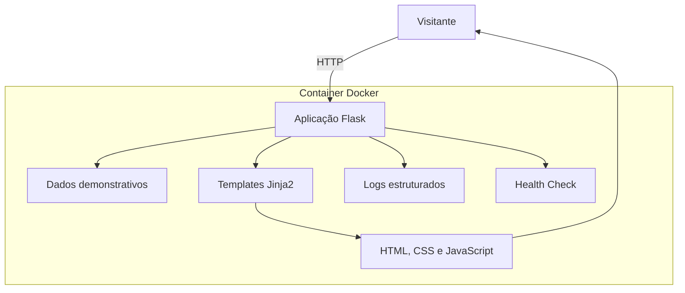
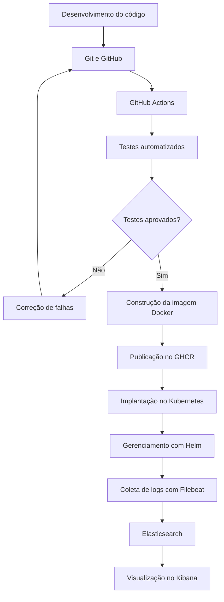

 
# Viaje+ — Portal de Turismo e Aplicação de Práticas DevOps

## 1. Sobre o projeto

O Viaje+ é uma aplicação web de divulgação de destinos turísticos nacionais e internacionais, desenvolvida com o objetivo de proporcionar aos visitantes uma experiência visual moderna e intuitiva para descobrir diferentes possibilidades de viagem.

A plataforma concentra sua experiência em uma página inicial (*Landing Page*), que reúne a apresentação do serviço, destinos turísticos em destaque e informações introdutórias sobre as possibilidades de viagem.

Entretanto, o desenvolvimento do Viaje+ não se limita à construção de uma aplicação web. O projeto também busca demonstrar, na prática, como os princípios e as ferramentas de DevOps podem ser aplicados ao ciclo de vida de um software, desde sua implementação até sua disponibilização e monitoramento.

## 2. Motivação e propósito

Em projetos de software, desenvolver uma aplicação funcional é apenas uma parte do processo. Também é necessário garantir que as alterações realizadas pelos desenvolvedores sejam verificadas, que o ambiente de execução seja reproduzível e que a disponibilização de novas versões ocorra de maneira organizada e confiável.

Nesse contexto, o Viaje+ foi concebido para explorar os desafios relacionados à integração entre desenvolvimento e operações de software.

A proposta é utilizar uma aplicação web relativamente simples como base para implementar um fluxo de trabalho DevOps, permitindo demonstrar como diferentes ferramentas podem atuar de maneira integrada para automatizar atividades, reduzir intervenções manuais e melhorar a confiabilidade do processo de entrega.

O projeto busca responder a questões como:

- Como garantir que alterações no código não comprometam funcionalidades existentes?
- Como automatizar a execução de testes a cada atualização do projeto?
- Como padronizar o ambiente de execução, evitando diferenças entre máquinas?
- Como automatizar a construção e a disponibilização de novas versões?
- Como organizar a execução da aplicação em ambientes de contêineres?
- Como acompanhar o comportamento da aplicação e analisar seus registros de execução?

Essas questões orientam as decisões tecnológicas e arquiteturais adotadas no projeto.

## 3. Objetivos

### 3.1 Objetivo geral

Desenvolver uma aplicação web integrada a um fluxo de práticas DevOps, demonstrando a utilização de automação, integração contínua, containerização, orquestração e observabilidade no ciclo de desenvolvimento e entrega de software.

### 3.2 Objetivos específicos

- Desenvolver uma aplicação web utilizando Python e Flask.
- Organizar o código-fonte e controlar suas alterações por meio do Git e GitHub.
- Implementar testes automatizados para validar o funcionamento da aplicação.
- Utilizar GitHub Actions para automatizar a integração contínua.
- Empregar Docker para padronizar e isolar o ambiente de execução.
- Utilizar o GitHub Container Registry para armazenar e disponibilizar imagens da aplicação.
- Explorar a implantação e o gerenciamento de contêineres utilizando Kubernetes e Helm.
- Implementar uma estrutura de coleta e visualização de logs com Filebeat, Elasticsearch e Kibana.

## 4. Arquitetura da solução

A arquitetura do Viaje+ foi planejada de forma modular e simplificada, separando a apresentação da interface, o processamento das requisições e o ambiente de execução.

A aplicação utiliza Flask como framework responsável pelo processamento das requisições HTTP e pela disponibilização dos conteúdos. Os dados demonstrativos dos destinos são mantidos diretamente no código-fonte, sem utilização de banco de dados, uma vez que o objetivo principal não é implementar um sistema de gestão de informações turísticas, mas utilizar a aplicação como base para os experimentos de DevOps.

A camada de apresentação utiliza HTML5, CSS3 e JavaScript, enquanto os templates Jinja2 permitem integrar os dados fornecidos pelo servidor à interface.

Para execução, o projeto utiliza Gunicorn como servidor WSGI e Docker para empacotar a aplicação e suas dependências em um ambiente isolado.

### 4.1 Visão geral da arquitetura

## 5. Estratégia DevOps e justificativa das tecnologias

A adoção de DevOps no Viaje+ tem como finalidade integrar as atividades de desenvolvimento, validação, empacotamento, disponibilização e acompanhamento da aplicação.

Em vez de tratar essas atividades como etapas isoladas e executadas manualmente, o projeto propõe um fluxo integrado, no qual cada ferramenta desempenha uma função específica.

### 5.1 Integração contínua (CI)

A integração contínua tem como objetivo automatizar a validação das alterações realizadas no código-fonte.

No Viaje+, essa prática é implementada utilizando GitHub Actions, responsável por executar os testes automatizados sempre que novas alterações são enviadas ao repositório.

A utilização de Pytest permite verificar se os principais recursos da aplicação continuam funcionando, identificando possíveis falhas antes que as alterações avancem para as próximas etapas.

A intenção é reduzir a dependência de verificações manuais e proporcionar maior segurança durante a evolução do projeto.

### 5.2 Entrega e implantação contínuas (CD)

A entrega contínua complementa a integração contínua ao automatizar as etapas posteriores à validação do código.

No projeto, a proposta é construir imagens Docker após a validação das alterações e disponibilizá-las no GitHub Container Registry (GHCR).

Essas imagens poderão ser utilizadas na implantação da aplicação em um ambiente Kubernetes, com os recursos de implantação organizados por meio do Helm.

O objetivo é estabelecer um processo mais consistente e reproduzível de disponibilização de novas versões, reduzindo operações manuais e facilitando a atualização da aplicação.

### 5.3 Containerização com Docker

O Docker foi escolhido para padronizar o ambiente de execução da aplicação.

Por meio da criação de uma imagem contendo o código-fonte e suas dependências, torna-se possível executar o Viaje+ em diferentes ambientes sem precisar reproduzir manualmente toda a configuração do Python e das bibliotecas utilizadas.

Essa abordagem também facilita a integração com ferramentas de orquestração e os processos automatizados de implantação.

### 5.4 Orquestração com Kubernetes e Helm

O Kubernetes será utilizado para demonstrar o gerenciamento da aplicação em um ambiente de contêineres.

Sua utilização permite explorar recursos como implantação, reinicialização de contêineres, exposição de serviços e gerenciamento de réplicas.

O Helm complementa essa abordagem ao permitir organizar e parametrizar os recursos necessários à implantação, facilitando a configuração e a atualização da aplicação.

Embora o Viaje+ seja uma aplicação pequena, a utilização dessas ferramentas permite compreender conceitos importantes de gerenciamento de aplicações em ambientes distribuídos.

### 5.5 Observabilidade e gerenciamento de logs

A observabilidade é importante para compreender o comportamento da aplicação durante sua execução e identificar possíveis problemas operacionais.

Para isso, o projeto prevê a utilização do Elastic Stack, composto por:

- **Filebeat:** responsável pela coleta e encaminhamento dos registros de execução.
- **Elasticsearch:** utilizado para armazenar e indexar os dados coletados.
- **Kibana:** responsável pela consulta, análise e visualização dos registros.

Essa estrutura permitirá acompanhar eventos registrados pela aplicação e demonstrar como ferramentas de monitoramento podem auxiliar na análise de seu funcionamento.

## 6. Fluxo de trabalho DevOps

O fluxo proposto para o Viaje+ integra as etapas de desenvolvimento, validação, construção e implantação.

Esse fluxo representa a integração pretendida entre as ferramentas e as práticas adotadas, permitindo compreender como o código desenvolvido pode percorrer um processo automatizado até sua execução e acompanhamento.

## 7. Tecnologias e ferramentas

| Tecnologia | Aplicação no projeto |
|---|---|
| Python | Desenvolvimento da aplicação |
| Flask | Processamento das requisições web |
| HTML5, CSS3 e JavaScript | Construção da interface |
| Jinja2 | Renderização dos templates |
| Pytest | Testes automatizados |
| Git e GitHub | Versionamento e colaboração |
| GitHub Actions | Automação da integração contínua |
| Docker | Containerização |
| Gunicorn | Servidor WSGI |
| GHCR | Armazenamento de imagens |
| Kubernetes | Orquestração de contêineres |
| Helm | Gerenciamento das implantações |
| Filebeat | Coleta de logs |
| Elasticsearch | Armazenamento e indexação de logs |
| Kibana | Análise e visualização de logs |

## 8. Considerações finais

O Viaje+ utiliza uma aplicação web de escopo reduzido como base para demonstrar práticas que podem ser aplicadas em projetos de software de diferentes dimensões.

A escolha por uma estrutura sem banco de dados e com funcionalidades concentradas em uma única página permite manter o foco nas atividades de engenharia de software e DevOps, sem introduzir complexidades que não são necessárias para os objetivos propostos.

A integração entre testes automatizados, CI/CD, Docker, Kubernetes e ferramentas de observabilidade busca demonstrar como a automação e a padronização podem contribuir para processos de desenvolvimento e entrega mais organizados, reproduzíveis e confiáveis.
